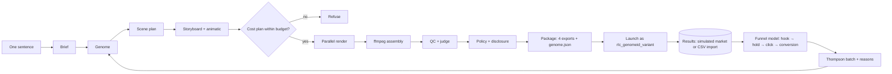
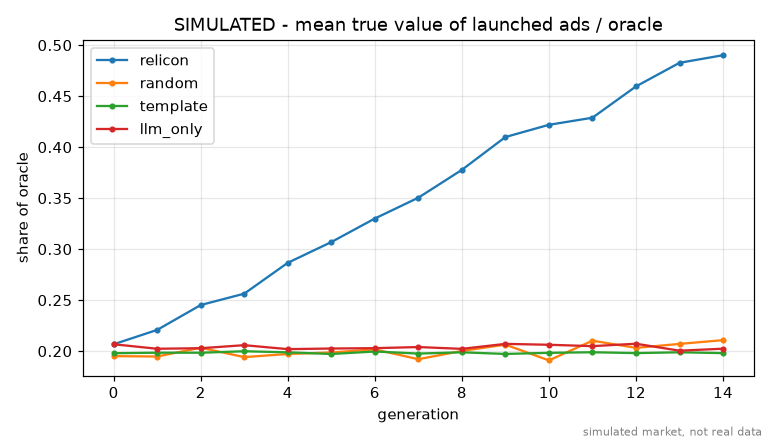

# Relicon: the self-improving ad engine

Relicon turns one sentence into a finished video ad, launches ad batches, reads results, and learns which creative choices work for each niche and platform.

Every ad is a **Creative Genome**: a JSON object with 34 learnable parameters (hook type, duration, pacing, music, CTA, offer and so on), plus fixed brief fields and derived production data. The schema lives in [`schemas/genome.v1.json`](schemas/genome.v1.json) and the TypeScript types in [`lib/genome.ts`](lib/genome.ts).

> **Honesty note.** Learning results in this repo come from a **simulated** market. They are labeled SIMULATED everywhere: in the data (`is_simulated: true`), the dashboard badges, the charts and the report. In zero-key mode the media are **mock renders**: real, playable MP4 files made with ffmpeg, but placeholders, not real ads.

## Status

| Part | Status | Notes |
|---|---|---|
| Genome schema, Pydantic models, TS types | Real | `engine/relicon/genome`, tagged learnable / fixed / derived |
| Sentence → brief → plan (6 s to 5 min, chapters, continuity bible) | Real | Rule-based without a key; Claude Sonnet plans when `ANTHROPIC_API_KEY` is set (untested here, no key) |
| Storyboard + animatic, cost plan, budget gate | Real | Refuses paid runs without a budget or over it; default $5 per ad |
| Render with mock providers | Real media, placeholder content | Keyframes, Ken Burns clips, synthetic voice and music |
| Render with paid providers (MiniMax Hailuo-02, ElevenLabs, Claude) | Code written, **not run** | Needs owner keys and a budget; see "Real ad" below |
| ffmpeg assembly: transitions, ducking, −14 LUFS, safe-zone captions, end card, 9:16/1:1/4:5/16:9 | Real | Checked by QC on every render |
| QC: technical checks + genome fidelity judge | Real (partial) | Mock judge measures 4 fields from pixels (D6); Claude vision judge needs a key |
| Ad policy check + AI disclosure | Real (rule-based) | Rules not re-checked against live platform policy pages |
| Simulated market (6 niches × 2 platforms), oracle | Real, **SIMULATED** by definition | Hidden truth in `simulator/truth`, never imported by learning (test enforced) |
| Learning engine: funnel model, pooling, Thompson batch, scene credit, fatigue, delay, insights, policy versions and rollback | Real | Tested on synthetic data with known answers and on the simulator |
| Evaluation report | Real, **SIMULATED** | [`evals/REPORT.md`](evals/REPORT.md) |
| CSV import (Meta, TikTok) | Real | Column presets not checked against a live export (D18) |
| Live Meta/TikTok API connectors | **Stub** | Behind `RELICON_LIVE_APIS=1`, raises `NotImplementedError` |
| Dashboard `/relicon` (Studio, Campaigns, Ads, Learning, Simulation Lab, Data) | Real, minimal UI | Runs without Supabase in demo mode |
| One real-provider ad | **Not done** | Needs the owner's keys and approval to spend |

## How it works



The learning model (D3): for each funnel step, a Bayesian linear model on the empirical logit, weighted by binomial information. Pooling runs global → vertical → niche → brand, and each level uses only its own data with the parent posterior as its prior. The objective for ROAS is:

$$ \text{ROAS} = \frac{1000 \cdot h \cdot c \cdot v \cdot \text{AOV}}{\text{CPM}} $$

where h is the hook rate (3 s views per impression), c is clicks per 3 s view and v is the conversion rate. Ranking uses only log h + log c + log v, because CPM and AOV are the same for every ad in a niche.

## Quick start (no keys, no network)

```bash
make setup      # Python 3.12 venv with uv, engine + dev deps
make test       # all tests, under a minute
make demo       # render an ad, run 6 simulated generations, render the learner's next pick, open the dashboard
make eval       # full evaluation -> evals/REPORT.md + charts (about 10 to 15 minutes on a weak laptop)
```

`make demo` uses Postgres from `docker compose` when Docker works, otherwise SQLite. The dashboard is at http://localhost:3000/relicon and the engine API at http://localhost:8000.

CLI:

```bash
relicon generate "hydrating serum for dry winter skin on reels" --duration 30 --budget 5
relicon simulate --scenario skincare_dry@meta_reels --generations 6
relicon learn skincare_dry           # fit, snapshot policy, print insights
relicon next skincare_dry --batch 8  # next batch with a reason per ad
relicon rollback skincare_dry p0002
relicon import results.csv --preset meta   # rows link by ad name rlc_<genome_id>_<variant>
relicon prices                        # verified provider prices with sources
```

## Results (SIMULATED)

See [`evals/REPORT.md`](evals/REPORT.md) for the full report, including robustness (high noise, drift, cold start) and production numbers for 6/15/30/60/300 s ads.



Development check (3 scenarios, 2 seeds, 15 generations of 8 ads; share of the oracle reached by the mean launched ad):

| method | gen 0 | gen 14 |
|---|---|---|
| Relicon | 19% | 50% |
| random | 20% | 21% |
| template | 19% | 19% |
| LLM-only (mock director) | 19% | 19% |

The full 12-scenario numbers are in the report.

What the numbers do not say: the market is invented, so these results show that the learning loop works as designed, not that it will lift a real ad account by the same amount. Conversion rate is close to unlearnable at $150 per ad (D16), so most of the gain comes from hook rate and clicks.

## Two-minute demo script

1. `make demo`. While it runs, say: "One sentence in, a finished 15-second ad out, with 4 aspect ratios, captions in safe zones and loudness at −14 LUFS." Open the first MP4 path it prints. Point at the MOCK RENDER label.
2. It then launches 6 generations of 8 ads into the simulated market. Say: "Each generation, the engine reads the results, updates its funnel model, and picks the next batch. Every pick has a written reason." Read one reason line aloud.
3. It renders the ad the learner proposes next. Open it.
4. In the browser at `/relicon`: **Learning** tab, show insights with 90% intervals and the scene drop-off table. Click "roll back here" on an older policy version.
5. **Simulation Lab** tab, show the evaluation curves: Relicon against random, template and LLM-only. Point at the SIMULATED badge and say what it means.
6. **Data** tab: "With real ads, export the CSV from Ads Manager and import it here. Rows link by ad name. Unmatched rows are listed, never guessed."

## Real ad (needs the owner)

Paid rendering is coded but has not run, because no keys are in this environment. To make one real ad within budget:

```bash
export ANTHROPIC_API_KEY=... MINIMAX_API_KEY=... ELEVENLABS_API_KEY=...
relicon --providers real generate "cold-brew coffee for night-shift nurses" --duration 15 --budget 5 --draft   # storyboard + cost plan first
relicon --providers real generate "cold-brew coffee for night-shift nurses" --duration 15 --budget 5
```

The cost plan is printed and saved before any paid call; the run refuses if the estimate is over the budget. A 15 s ad on the default stack is estimated in `cost_report.json` (MiniMax Hailuo-02 at $0.28 per 6 s 768P clip, checked 2026-11-23, D4).

## Repo map

| Path | What |
|---|---|
| `engine/relicon/genome` | Schema, search space, priors, export to JSON Schema and TS |
| `engine/relicon/pipeline` | Brief, planner, cost, render, assembly, QC, policy, job graph |
| `engine/relicon/providers` | Mock, Anthropic, MiniMax, legacy adapters, verified prices |
| `engine/relicon/simulator` | Scenarios, market, oracle; `truth/` is hidden from learning |
| `engine/relicon/learning` | Features, funnel model, bandit, credit, fatigue, insights, policy |
| `engine/relicon/performance` | Result interface, CSV import, live connector stub |
| `engine/relicon/evals` | Closed-loop harness and report |
| `engine/relicon/api.py` | FastAPI for the dashboard (SSE job events) |
| `app/relicon` | Dashboard console |
| `docs/` | AUDIT, ARCHITECTURE, PLAN, DECISIONS |

The old engine (`engine/core`, `engine/providers`) is kept only behind adapters; see `docs/AUDIT.md`. Old MP4 outputs were removed from the tree but remain in git history unless the history is rewritten.
