# Architecture

```mermaid
flowchart LR
  S[One sentence] --> B[Brief expansion]
  B --> G[Genome proposal<br/>learning engine or priors]
  G --> P[Script + scene plan<br/>chapters + continuity bible]
  P --> SB[Storyboard + animatic]
  SB --> C[Cost plan + budget gate]
  C --> R[Full render<br/>scenes in parallel]
  R --> A[ffmpeg assembly<br/>ducking, LUFS, captions, end card, 4 aspects]
  A --> Q[QC: technical + judge]
  Q --> PC[Ad policy check]
  PC --> K[Package: videos, genome.json, manifest, cost report]
  K --> PS[(PerformanceSource<br/>SimulatedMarket / CsvImport / Live API)]
  PS --> L[Learning engine<br/>hierarchical funnel model]
  L --> I[Insight memory + policy snapshot]
  L --> G
```



## Code layout

| Path | Role |
|---|---|
| `engine/relicon/genome/` | Creative Genome Pydantic models, field tags (`learnable`, `fixed`, `derived`), search space, JSON Schema export, TS type export. |
| `engine/relicon/providers/` | Provider interfaces (text, image, video, voice, music, sfx, judge), mock providers that make real playable media, Anthropic text provider, adapters around the original `engine/providers/*` clients, verified price table. |
| `engine/relicon/pipeline/` | The 10-step job graph: brief, planner, storyboard, cost, render, assembly, QC, policy, package. `jobs.py` gives content-hash caching, retries and progress events. |
| `engine/relicon/performance/` | `PerformanceSource` interface, normalized metrics, CSV import with Meta and TikTok presets, live connectors behind `RELICON_LIVE_APIS=1`. |
| `engine/relicon/simulator/` | `truth/` (hidden response functions, seeded), `market.py` (the only public simulator surface), `oracle.py` (evaluation only). |
| `engine/relicon/learning/` | Feature encoding, hierarchical Bayesian funnel model, Thompson-sampling batch selection, creative director, insights, fatigue, attribution delay, policy snapshots. Never imports `simulator.truth` (tested). |
| `engine/relicon/evals/` | `relicon eval`: learning curves, regret, robustness, fidelity, production numbers, `evals/REPORT.md`. |
| `engine/relicon/store.py` | SQLAlchemy document store. Postgres from `docker compose`, SQLite fallback. |
| `engine/relicon/api.py` | FastAPI router mounted by `engine/server.py`, with SSE job streaming. |
| `engine/relicon/cli.py` | `relicon generate | simulate | import | learn | next | eval | demo`. |
| `app/dashboard/*` | Studio, Campaigns, Ads, Learning, Simulation Lab, Data. Talks to the engine API. |
| `schemas/genome.v1.json` | Generated JSON Schema. `lib/genome.ts` holds the generated TS types. |

## The learning boundary

```
learning/  ──reads──>  performance.base (metrics only)  <──writes──  simulator.market
                                                                       │
                                                         simulator.truth (hidden)
```

`learning/` sees only result rows with counts. `tests/test_boundary.py` parses every file under `learning/` and fails on any import of `simulator.truth`, and also checks that importing the learning package does not load it.

## Funnel model

The model and the simulator use the same funnel shape (the simulator's numbers stay hidden):

| Step | Rate | Learned from fields |
|---|---|---|
| Impression to 3 s view | hook_rate | hook.*, visual.style, format.aspect_ratio |
| 3 s view to completion | hold_rate | format.duration_s, structure, avg_shot_length_s, narrative.*, audio.*, visual.* |
| 3 s view to click | click_rate | text.*, offer_mechanics.*, narrative.angle, cta timing |
| Click to conversion | cvr | offer_mechanics.*, narrative.angle, proof types |

Primary objective, per 1,000 impressions:

$$ \text{ROAS} = \frac{1000 \cdot h \cdot c \cdot v \cdot \text{AOV}}{\text{CPM}} $$

h is hook_rate, c is click_rate (per 3 s view), v is cvr. CPA is CPM / (1000 · h · c · v).
