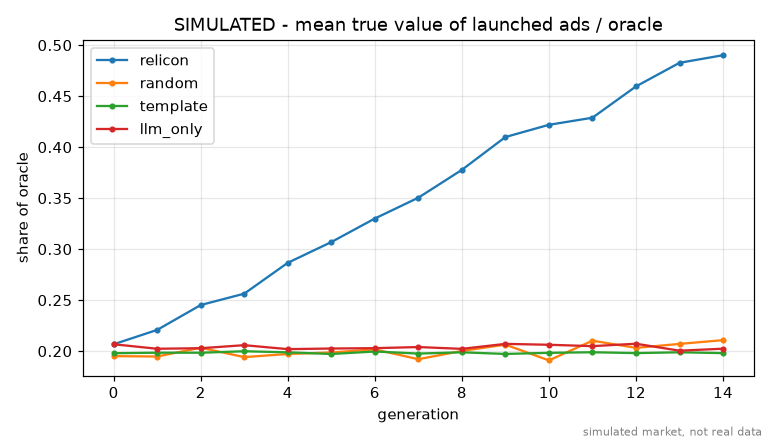
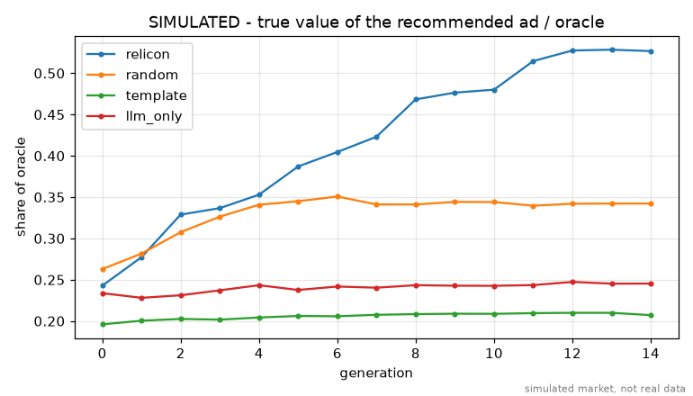
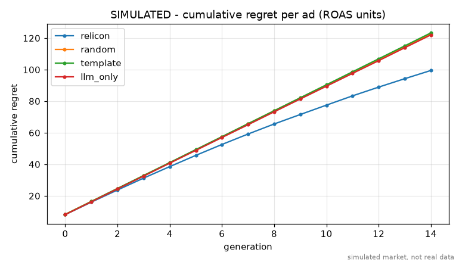
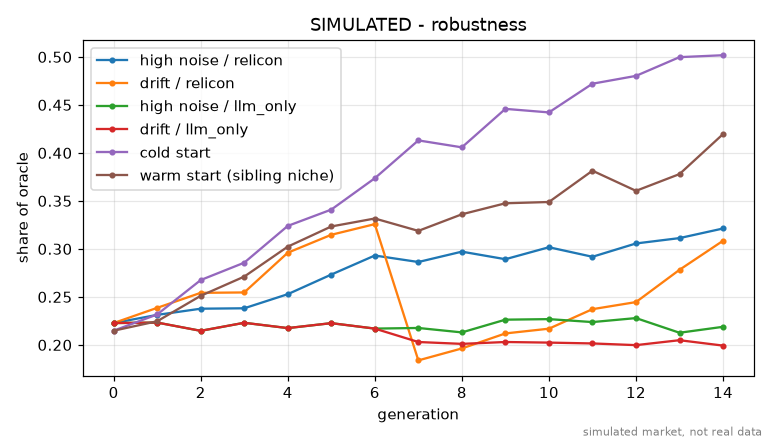

# Relicon evaluation report

> **SIMULATED.** Every number below comes from a made-up market in `engine/relicon/simulator`. It is not real ad performance.

Generated 2026-11-23 16:40 UTC, commit `35114ca`, runtime 2822 s, mode `full`.

Setup: 12 scenarios (niche x platform), seeds [1, 2, 3], 15 generations, 8 ads per generation, $150 per ad for 7 days, results read after the 7-day attribution window. The oracle is the best genome found by coordinate ascent on the hidden truth (a lower bound on the true optimum). Baselines: `random` (random genomes), `template` (best-practice template plus copy tweaks), `llm_only` (mock creative director with priors and no data, D8: no API key in this run).

## Main result

| method | gen 0 | gen 7 | gen 14 | recommended ad, last gen | cumulative regret |
|---|---|---|---|---|---|
| relicon | 21% | 35% | 49% | 53% | 99.5 |
| random | 20% | 19% | 21% | 34% | 122.6 |
| template | 20% | 20% | 20% | 21% | 123.3 |
| llm_only | 21% | 20% | 20% | 25% | 122.0 |

Share of oracle = true expected ROAS of the ad / oracle ROAS, averaged over runs.

## Impressions until the recommended ad reaches a share of the oracle

| method | 50% | 75% | 90% |
|---|---|---|---|
| relicon | 1.06M (24/36 runs) | 1.50M (5/36 runs) | not reached (0/36) |
| random | 0.81M (3/36 runs) | not reached (0/36) | not reached (0/36) |
| template | not reached (0/36) | not reached (0/36) | not reached (0/36) |
| llm_only | not reached (0/36) | not reached (0/36) | not reached (0/36) |

 

## Robustness

| condition | relicon, last gen | llm_only, last gen |
|---|---|---|
| high noise | 32% | 22% |
| drift | 31% | 20% |
| cold start (no history) | 50% | - |
| warm start (history from sibling niche, same vertical) | 42% | - |

First generation, cold vs warm: 21% vs 21%. High noise = ad-level noise 0.5 logit and 35% of the budget. Drift = the hook and click effects flip at generation 7.

## Per scenario (relicon vs best baseline, last generation)

| scenario | relicon | best baseline |
|---|---|---|
| coffee_nightshift@tiktok | 51% | 26% (template) |
| coffee_nightshift@meta_reels | 55% | 26% (template) |
| skincare_dry@tiktok | 46% | 23% (random) |
| skincare_dry@meta_reels | 59% | 13% (random) |
| skincare_teen@tiktok | 40% | 18% (random) |
| skincare_teen@meta_reels | 60% | 33% (random) |
| fitness_home@tiktok | 52% | 33% (template) |
| fitness_home@meta_reels | 41% | 32% (llm_only) |
| saas_freelance@tiktok | 52% | 16% (random) |
| saas_freelance@meta_reels | 36% | 21% (llm_only) |
| pets_senior@tiktok | 57% | 20% (random) |
| pets_senior@meta_reels | 39% | 19% (random) |

## Production (mock providers, this machine)

| duration | scenes | chapters | render time | technical QC | genome fidelity (measured fields) | real-stack cost estimate |
|---|---|---|---|---|---|---|
| 6 s | 2 | 0 | 4.8 s | pass | 100% (4) | $0.58 |
| 15 s | 6 | 0 | 9.5 s | pass | 100% (4) | $1.72 |
| 30 s | 12 | 0 | 17.0 s | pass | 100% (4) | $3.71 |
| 60 s | 24 | 0 | 32.2 s | pass | 100% (4) | $7.12 |
| 300 s | 60 | 7 | 174.6 s | pass | 75% (4) | $17.37 |

Mock renders are placeholder media. Fidelity covers only fields measurable without a vision model (D6). Real-stack cost uses verified prices only (MiniMax Hailuo-02, ElevenLabs, Claude); ads over the $5 default budget are refused unless the job budget is raised.

## Limits

- The market is invented. Its effect sizes were set so the oracle is a few times better than a median ad; real markets may be flatter or steeper.
- Conversion rate is close to unlearnable at $150 per ad (about 5 conversions per ad). Relicon mostly learns hook rate and clicks, which caps how close it gets to the oracle.
- Model settings (prior sd 0.12, local candidate pool) were picked on `coffee_nightshift@tiktok`; all scenarios use different market seeds.
- The LLM-only baseline is the mock director in this run. With `ANTHROPIC_API_KEY` it would call claude-opus-5-5.
